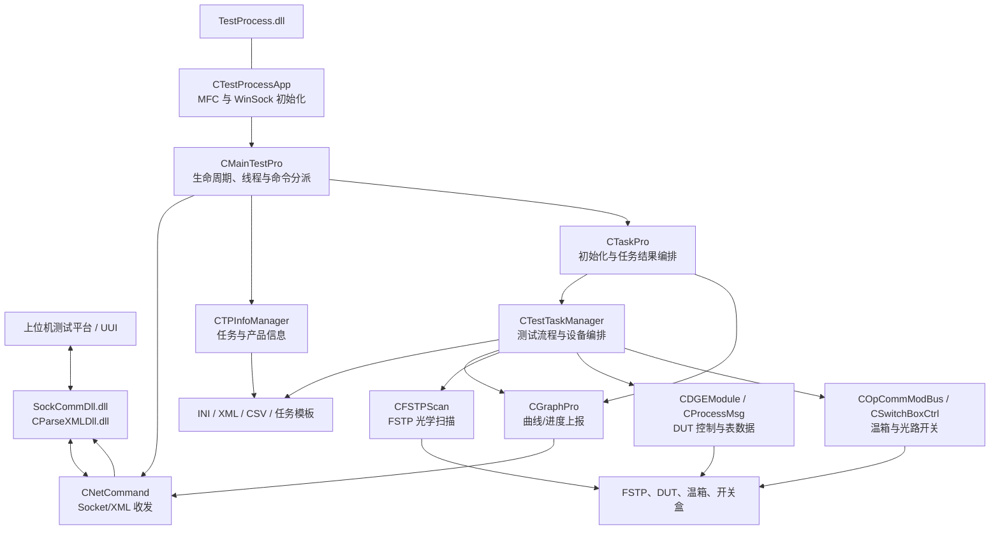
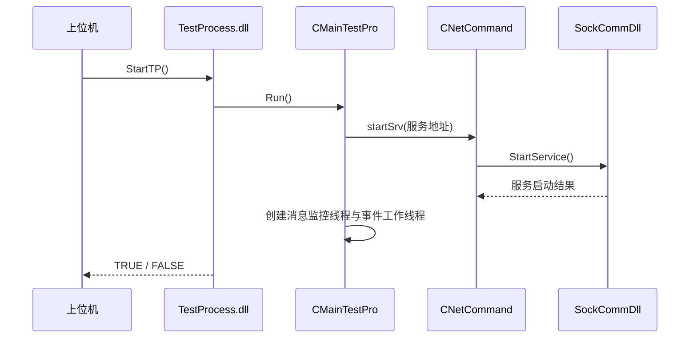
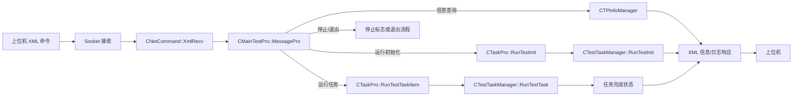
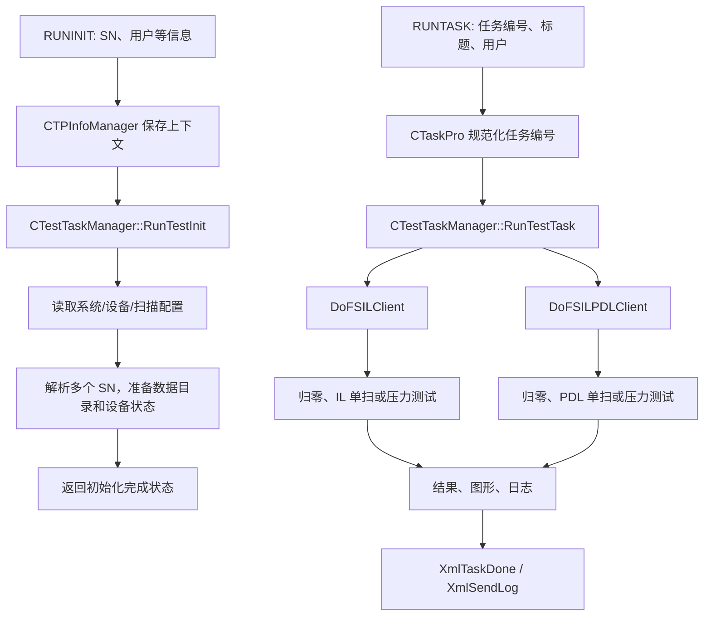
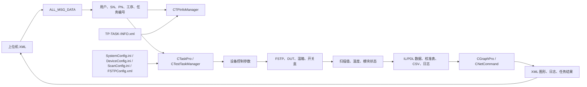

# TestProcess 项目概述

## 1. 项目定位

`TestProcess` 是 FSTP 测试平台中的一个 Windows 动态链接库（DLL）。它不提供独立的桌面界面，而是由上位机测试平台加载，通过 Socket/XML 协议接收测试指令，驱动光学测试设备与被测模块（DUT），再将任务状态、日志、曲线和测试结果返回给上位机。

当前解决方案只包含一个 C++ 工程：`src/TestProcess.sln` 中的 `TestProcess`。该工程产出 `bin/TestProcess.dll`。`SockCommDll.dll`、`CParseXMLDll.dll`、`UDL2_Server.dll` 和 FSTP 设备库均为外部运行时依赖，不属于本仓库的可构建工程。

从已配置的任务模板看，当前主要业务是 FSTP 光学扫描，包括 IL（插入损耗）和 PDL（偏振相关损耗）的归零扫描、单次扫描与压力测试。代码中同时保留了 DGE 模块校准、LUT 下载、固件升级、温箱循环、光路开关控制等能力，部分能力尚未接入当前默认任务分派。

## 2. 基础技术栈

| 类别 | 技术/组件 | 用途 |
| --- | --- | --- |
| 开发语言 | C++，MFC | DLL 宿主、线程、字符串、集合和 Windows 资源管理。 |
| 目标平台 | Windows x86 / Win32 | 解决方案提供 `Debug|Win32` 与 `Release|Win32` 配置。 |
| 构建工具 | Visual Studio 2015，`v140_xp` 工具集 | 旧版 Visual C++ 工程，动态链接 MFC。 |
| 网络协议 | Socket + XML | 与测试平台交换命令、日志、任务状态、基础信息和图形数据。 |
| 运行期通信 DLL | `SockCommDll.dll`、`CParseXMLDll.dll` | 分别提供 Socket 服务和 XML 序列化/反序列化；由 `CNetCommand` 动态加载。 |
| XML/COM | MSXML 4、`UDL2_Server.dll` | XML 文件处理及 FSTP/UDL 相关 COM 接口。 |
| 硬件通信 | 串口、Modbus、GPIB、厂商设备 API | 连接 DUT、温箱、光路开关盒和 FSTP 光学测试设备。 |
| 配置与数据 | INI、XML、CSV、任务包 | 设备连接、FSTP 扫描参数、任务菜单、校准表和测试结果。 |

> 源码中有中文注释和字符串，且使用历史 ANSI/MBCS 编码。修改既有 C++、INI、XML 或日志文件时应保持其原始编码，不能进行无关的 UTF-8 批量转换。

## 3. 工程与目录组织

| 路径 | 作用 |
| --- | --- |
| `src/` | 唯一 C++ DLL 工程的源文件、资源、解决方案和项目配置。 |
| `include/` | 平台公共接口、消息结构、任务/图形接口和 FSTP API 声明。协议数据布局是兼容性边界。 |
| `lib/` | 本地依赖及类型库文件，例如 `msxml4.dll`。 |
| `bin/` | DLL 部署输出、运行配置、任务定义 `TP-TASK-INFO.xml`、数据和发布内容。 |
| `bin/Config/` | `SystemConfig.ini`、`DeviceConfig.ini`、`FSTPConfig.xml`、扫描配置和模板目录。 |
| `data/` | 历史任务包与扫描临时数据。 |
| `FSTPLog/`、`Log/` | 运行与历史日志，可能包含生产或站点信息。 |
| `UUI_Debug/` | 上位机调试辅助配置、日志和 XML 数据。 |

### 工程配置与部署依赖

`src/TestProcess.vcxproj` 将输出设置为 `bin/TestProcess.dll`。工程中仍包含机器相关的绝对包含目录、库目录和 `UDL2_Server.dll` 导入路径；迁移构建环境时应通过本地属性表或项目设置解决这些依赖，不应将个人目录直接提交到源码。

运行时至少需要与 DLL 同一部署环境中的 `SockCommDll.dll`、`CParseXMLDll.dll`，以及可用的 MSXML、UDL/FSTP 设备依赖和 `bin/Config/` 配置。`CMainTestPro::StartSocket` 当前直接使用 `172.0.0.1` 作为服务地址，该地址并非从配置文件读取。

## 4. 架构组织图

架构可概括为四层：

1. **宿主与协议层**：上位机通过外部 Socket/XML DLL 与 `CNetCommand` 通信。
2. **控制与编排层**：`CMainTestPro` 维护服务、线程和消息分派；`CTaskPro`、`CTPInfoManager` 分别负责任务与信息业务。
3. **测试执行层**：`CTestTaskManager` 组织初始化、扫描、校准、结果保存和硬件连接。
4. **设备与数据层**：FSTP、DUT、温箱、开关盒及 INI/XML/CSV/任务包共同构成实际测试环境。

## 5. 核心业务流

### 5.1 DLL 启动与通信建立

1. MFC 在 `CTestProcessApp::InitInstance` 中初始化 WinSock。
2. 宿主调用导出函数 `StartTP`，转入全局 `CMainTestPro g_tp` 的 `Run` 方法。
3. `CNetCommand` 通过 `LoadLibrary` 加载 Socket/XML 外部 DLL，并解析所需函数地址。
4. `Run` 启动 Socket 服务，创建消息监控线程和事件工作线程。
5. 宿主可调用 `StopTP` 停止服务；`GetError` 读取控制器保存的最近错误信息。

### 5.2 命令接收、分派与反馈

`CMainTestPro::MessagePro` 从 `CNetCommand` 取得 `ALL_MSG_DATA`，依据 `nDataType` 区分消息：

- 配置路径、模板、任务清单、工站信息等请求会调用 `XmlFeedback` 完成同步反馈。
- `MSG_COMMAND_RUNINIT` 触发测试初始化。
- `MSG_COMMAND_RUNTASK` 投递到事件工作线程执行单项任务。
- `MSG_MSG_TASKINFO`、`MSG_MSG_BASEINFO`、`MSG_MSG_TASKDESCRIPTION` 由 `CTPInfoManager` 返回元数据。
- 停止与退出命令设置停止状态或结束主循环。

任务成功或失败后，`CTaskPro` 使用 `XmlTaskDone` 发送 `TASK_DONE` 或 `TASK_FAIL`，并使用 `XmlSendLog` 发送过程日志。

### 5.3 测试初始化与任务执行

任务菜单来自 `bin/TP-TASK-INFO.xml`：以 `SPEC`、`PN`、`LEVEL`、`TaskNode` 描述任务层级、适用工序和 PN。`CTPInfoManager` 加载该文件后，按当前工序与 PN 筛选任务，再向上位机发送任务编号和标题。

当前模板定义两组 FSTP 任务：

| 分组 | 任务 | 含义 |
| --- | --- | --- |
| FSIL | 101 / 102 / 103 | IL 归零扫描、IL 单次扫描、IL 压力测试。 |
| FSIL_PDL | 201 / 202 / 203 | 带 PDL 的归零扫描、单次扫描、压力测试。 |

界面侧传入的任务编号包含菜单层级偏移。`CTaskPro::RunTestTaskItem` 对大于等于 `TASK_OFF_1000` 的编号取模，得到底层任务编号后交给 `CTestTaskManager`。当前 `RunTestTask` 直接调用 `DoFSILClient` 和 `DoFSILPDLClient`；该类内其余校准/验证方法虽存在，但在该默认分派中处于未启用或注释状态。

## 6. 核心数据流

数据按用途可分为五类：

| 数据 | 主要来源 | 主要消费者 | 说明 |
| --- | --- | --- | --- |
| 命令上下文 | 上位机 XML | `CTPInfoManager`、`CTaskPro` | 包含用户、SN、PN、工序、任务编号和标题。 |
| 任务定义 | `TP-TASK-INFO.xml` | `CTPInfoManager` | 决定菜单层级、任务可见性和任务 ID。 |
| 环境配置 | `bin/Config/` 下 INI/XML | `CTestTaskManager`、`CFSTPScan` | 包含设备连接、路径、扫描和 FSTP 参数。 |
| 测量与过程数据 | FSTP、DUT、温箱、开关盒 | `CTestTaskManager`、`CDGEModule` | 包含 IL/PDL 扫描值、温度、串口响应和设备状态。 |
| 对外结果 | XML、日志、曲线、文件 | 上位机与数据目录 | 包含任务完成状态、日志、图形数据、CSV/报告和校准产物。 |

## 7. 主要类与职责

| 类 | 所在模块 | 职责 |
| --- | --- | --- |
| `CTestProcessApp` | `TestProcess.*` | MFC 应用对象；初始化 WinSock。 |
| `CMainTestPro` | `MainTestPro.*` | DLL 运行主控制器；启动/停止服务，管理消息监控与事件工作线程，分派收到的命令。 |
| `CNetCommand` | `NetCommand.*` | XML Socket 通信适配器；动态加载通信/解析 DLL，序列化/反序列化消息，发送日志、结果、图形和平台服务请求。 |
| `CTPInfoManager` | `TPInfoManager.*` | 管理上位机传入的 SN、PN、工序和用户；加载任务 XML，生成任务列表、基础信息和任务描述。 |
| `CTaskPro` | `TaskPro.*` | 测试服务层；执行初始化或单项任务，统一发送任务成功/失败状态并连接信息、网络和图形对象。 |
| `CTestTaskManager` | `TestTaskManager.*` | 最大的测试编排类；负责任务执行、设备连接、配置读取、FSTP 扫描、生产数据目录、校准、验证和结果处理。 |
| `CGraphPro` | `GraphPro.*` | 将图表初始化、曲线新增和 XY 数据点转换为 XML 图形消息并发送给上位机。 |
| `CFSTPScan` | `FSTPScan.*` | FSTP 测量设备适配层；打开/关闭设备、设置扫描参数、执行 IL/PDL 扫描、参考扫描以及读写扫描结果。 |
| `CDGEModule` | `DGEModule.*` | DUT 模块操作与数据表管理；读取温度/SN，生成并下载 Mapping、制造信息、波长、衰减、IL、Beam 等表，支持固件更新。 |
| `CProcessMsg` | `ProcessMsg.*` | DUT 底层协议封装，定义对象 ID、读写命令、响应长度和设备控制消息。 |
| `COpComm` | `OpComm.*` | 通用串口读写与端口生命周期管理。 |
| `COpCommModBus` | `OpCommModBus.*` | 温箱通信适配，支持 Modbus RTU 与部分 GPIB/串口温箱操作。 |
| `CSwitchBoxCtrl` | `SwitchCtrl.*` | 测试光路开关盒控制，按设备类型和端口选择光路。 |
| `CXMLControl` | `XMLControl.*` | 基于 MSXML 的本地 XML 文档加载、节点查找、属性读取、修改与保存。 |
| `CCalpolyn` | `Calpolyn.*` | 校准数据的多项式计算支持。 |
| `COpCRC32` | `OpCRC32.*` | 固件、表文件和传输数据的 CRC32 校验。 |

## 8. 外部接口与兼容性边界

以下内容与上位机或硬件环境紧密耦合，修改前必须同步评估消费者：

- DLL 导出函数：`StartTP`、`StopTP`、`ShowDialog`、`GetError`。
- `include/` 中的 `ALL_MSG_DATA`、消息 ID、任务状态枚举、图形结构和网络接口。
- `SockCommDll.dll` 的服务、收发和错误查询函数名。
- `CParseXMLDll.dll` 的 XML 解析、生成和图形 XML 生成函数名及数据布局。
- FSTP API、UDL COM 类型库、DUT 串口协议、温箱 Modbus 协议和开关盒协议。
- `bin/Config/` 与 `TP-TASK-INFO.xml` 中的部署路径、设备地址、PN/工序和任务定义。

## 9. 阅读与排查建议

要理解一次任务为何没有执行或为什么结果未返回，可按以下顺序追踪：

1. 从 `src/TestProcess.cpp` 的 `StartTP` 确认 DLL 是否已启动。
2. 查看 `src/MainTestPro.cpp` 的 `MessagePro` 是否识别到对应消息类型。
3. 查看 `src/TaskPro.cpp` 是否接收到正确的任务编号、用户和标题。
4. 查看 `src/TPInfoManager.cpp` 是否成功加载当前工作目录下的 `TP-TASK-INFO.xml`，且 PN/工序筛选匹配。
5. 查看 `src/TestTaskManager.cpp` 中任务编号对应的 FSTP 扫描分支与配置加载结果。
6. 检查 `bin/Config/`、外部 DLL、设备连接以及 `FSTPLog/`、`Log/` 中的运行日志。

对协议、线程、配置、设备控制或任务编号的改动，还应遵循 `AGENTS.md` 中的兼容性、代码评审和集成验证要求。